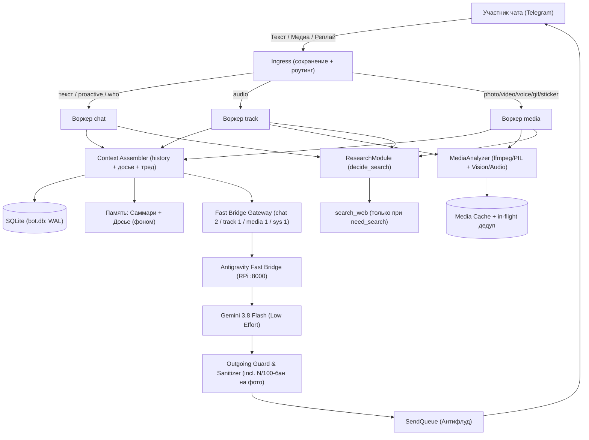

# Funny Bot («Дик»)

Автономный, саркастичный и контекстно-осведомленный Telegram-бот для групповых чатов с долгосрочной памятью (досье на каждого участника), глубоким мультимодальным анализом медиа (музыка, войсы, видео, фото, стикеры, мемы), умным автономным ресерчем в сети и адаптивным характером.

---

## Архитектура и ключевые возможности



### 0. Воркеры и живой флоу (как человек)
- **Разделение**: `chat` — дефолтное общение (текст, проактив, `/who`), `track x2` — только треки (`audio`, два воркера round-robin: треки идут пачками), `media` — все остальные медиа, `sys` — фон (досье, обучение банка, чистки). Реализация — `src/tg/lanes.py` (`LanePool`), роутинг — `route_lane()` по типу вложения с учётом реплая.
- **Изоляция**: у каждого воркера своя FIFO-очередь (`WORKER_QUEUE_MAX`) и свой лимит в гейтвее (`CHAT=1 / TRACK=2 / MEDIA=1 / SYS=1`, сумма `<= MAX_CONCURRENT=6`), плюс своя тёплая сессия моста `tg_<chat>:<worker>` (трековые не делят контекст). Медленная гифка в `media` не душит `chat`.
- **Ingress не ждёт**: `handle_message` только сохраняет сообщение и кладёт задачу в очередь, тяжёлая работа идёт в воркерах. Досье и обучение — задачами в `sys`-воркер, а не `await` в горячем пути.
- **По-человечески**: `typing`-keepalive каждые `TYPING_KEEPALIVE_S=4с` на всё время генерации (а не один раз), медиа и история грузятся параллельно (`asyncio.gather`), `ffmpeg/PIL/base64` — через `to_thread` (не блокируют loop).
- **Ускорение медиа**: фото жмётся до `PHOTO_MAX_DIM=1280 / JPEG q72` (вместо 5МБ оригинала в base64), видео — первые `VIDEO_MAX_S=20с / 480p / veryfast` (было 60с), гифка — первые `ANIM_MAX_S=4с / 480p / без аудио` (главный фикс ступора). Повторный разбор одного `file_unique_id` дедуплицируется (in-flight).
- **Ответ от контекста, а не дефолт-оценка**: `media_reply` всегда собирается с полным контекстом (`history + досье + тред + caption`), в промпте (`mode_media_reply.txt`, `mode_ping.txt`) требуется зацепка за разговор (досье/автор — по желанию, без гиперфикса), запрещены generic-фразы вида «кроссовер годный» без привязки к чату.
- **Чей реплай**: стрелки истории вида `(→id|uM)`, в `<current>` вторая строка `[ответ на #id от uM «ник»: текст цели]`, в `<media>` поля `sent_by`/`requested_by` + `reply_target` в `<request>`. Трек чужой, просит другой — модель видит обоих и не приписывает вложение просившему.
- **Отпор на провокации**: детектор прямой агрессии/оскорблений/посылов/разводок в адрес бота (`antijob/detector.py`, флаг `provoked` в `<request>`) — в этом режиме гиперкратко, буквально пара слов (2–6 слов, без вопросов), без заезженных концепций (никаких «по ip», «вычислю», списков) — примеров в промпте нет, модель импровизирует; не влетело в гард — repair, а не вялая отмазка.
- **Анти-повтор и анти-склейка**: свои последние реплики видны в `<history>` + запрет бить в одну зацепку дважды (промпт) + кодовый гард (`is_repetitive` → repair); срезы досье ротируются по `message_id`, соседние запросы видят разные факты. Склейки «констатация, подъёб» через запятую запрещены промптом и гардом (`has_comma_glue` → repair).
- **Настроение чата** (`src/persona/mood.py`, флаг `mood` в `<request>`): `serious` (просят объяснить/подсказать) — по делу, без роаста в лоб; `banter` (срач/угар) — как обычно жёстко; `neutral` — дефолт. Контекстное окно `CTX_LAST=100`.
- **Живой банк стиля** (`src/style/learner.py`): фразы копятся в `prompts/style_examples.candidates.yaml` (с контекстом — на что был ответ), полными батчами идут на P2-проверку `style_filter` («самые человечные»), прошедшие дописываются в `prompts/style_examples.yaml` (потолок `STYLE_EXAMPLES_MAX=128`). Переполнение — вытеснение решением ИИ (`style_evict`: смотрит банк + «предложку», может не вытеснить ничего; жёсткий потолок `max+16` — FIFO), пермач не трогается никогда; лёг ИИ — честный FIFO. Каждый запрос — взвешенная подвыборка `STYLE_EXAMPLES_N=8`: прайм (хиты по смеякам) первым, пермач всегда. Файлы в `.gitignore`, на RPi не затираются деплоем.
- **Смеяки как сигнал** (`src/tg/reactions.py`): 3+ distinct смеяк на сообщении — сразу в банк, минуя очередь и фильтр (смех чата и есть вердикт; 0 реакций — обычный путь, решает фильтр). Это НЕ пермач: при чистке вылетают решением ИИ на общих основаниях. Пермач — только сиды (`STYLE_PINNED_SEEDS`, дефолт «бум»). 1–2 смеяки — в очередь на отбор. Свои исходящие бот пишет в БД (`is_bot=1`, в досье не идут) — модель видит свои реплики в истории, а смеяки на них резолвят текст + контекст реплая.

### 1. Antigravity Fast Bridge (LLM Gateway)
- Локальный высокопроизводительный шлюз на FastAPI/Uvicorn, работающий в связке с Antigravity CLI (`agy`).
- Поддержка модели `gemini-3.8-flash-low` со сверхнизким latency и возможностью масштабирования до `medium`/`high` и `gemini-3.1-pro`.
- Пул pre-warmed CLI-воркеров на RAM-диске (`/dev/shm`), мгновенный старт генерации без задержек дискового ввода-вывода.
- Автоматическая передача медиафайлов (изображения, аудио, видео) через локальный RAM-буфер.
- Раздельные слоты и таймауты по лейнам: `chat 1 / 35с`, `track 2 / 50с`, `media 1 / 75с`, `sys 1 / 75с` (фон P2: досье, style_filter/style_evict — отдельно, не душит юзерскую медийку). На медиа (трек/фото/видео) `search_web`-директива с готовым запросом идёт всегда; на текст — только при `need_search` (экономия токенов на обычных пингах).

### 2. Мультимодальный анализ вложений (On-Demand P0)
- **Музыка и треки (`audio`, воркеры `track x2`)**: определение исполнителя, названия, жанра, настроения и выставление честной оценки по 100-балльной шкале (`N/100`, используется вся шкала от 0: тишина — 0–5, середняк — 30–65, хит — 85+) первой строкой + 1–2 предложения микрорецензии с привязкой к контексту на усмотрение модели (досье автора — только если к месту, без гиперфикса). Тишина режется кодом (`ffmpeg volumedetect`, ≤−50 дБ → скор 0 без LLM — никаких выдуманных «дудок»), жанр — только по услышанному, иначе `null`.
- **Фотографии и мемы (`photo`, воркер `media`)**: глубокий OCR (вычитка реплик и надписей на картинке), определение сути юмора, персонажей и визуального контекста. **Баллы `N/100` для картинок и мемов строго запрещены** — бот дает живую реакцию от контекста беседы (кто кинул, что обсуждали, досье автора). Запрет enforced дважды: repair в гарде (`contains_forbidden_score`) + финальный strip перед отправкой.
- **Стикеры (`sticker`)**:
  - Статические стикеры (`.webp` -> `.jpg`).
  - Видео-стикеры (`.webm` -> `.mp4` через ffmpeg).
  - Анимированные стикеры (`.tgs` с извлечением превью).
- **Голосовые и видеозаметки (`voice`, `video_note`)**: транскрипция речи, извлечение сути и тона без выставления численных баллов.
- Все медиа анализируются по запросу (P0 на прямой пинг или реплай) без тяжелых фоновых очередей.

### 3. Автономный веб-поиск и ресерч (Autonomous Research)
- Двухэтапный модуль принятия решений `decide_search`:
  1. Автоматически анализирует текущую реплику, историю чата, прикрепленное медиа и распознанный `ocr_text`.
  2. Если в вопросе («в чем мем», «при чем тут...», «поясни») или на картинке фигурирует город, персона, событие или нестыковка (например, слухи о вспышке чумы в Иркутске), модуль ставит `need_search=true` и генерирует точечный новостной запрос (например: `Иркутск новости происшествия что произошло`).
  3. **Правило анти-мусора**: бот не ищет слова «мем», «кроссовер» (выдающие мусор из соцсетей), а ищет реальные первоисточники и новости.
- На любое вложение поиск идёт всегда: детерминированный запрос строится кодом из разбора (`build_media_search_query`: трек — исполнитель+название, мем — текст на картинке, дальше суть/подпись), LLM-гейт — только запасной путь.
- Полная анонимизация поисковых запросов (`anonymize_query`): вырезание Telegram `@username`, `uN`, номеров и любых форм имени бота (`дик`).
- Прямой вызов инструмента `search_web` через модель с изучением фактов и выдачей едкого ответа.
- Полная анонимизация поисковых запросов (`anonymize_query`): вырезание Telegram `@username`, `uN`, номеров и любых форм имени бота (`дик`).

### 4. Характер, тон и защита от нейросетевых клише
- **Стиль общения**: разговорный, едкий, слегка небрежный телеграм-стиль — строго со строчной буквы в начале предложений, без точек в конце коротких фраз, без вылизанной книжной пунктуации.
- **Запрет дефолтных связок для оскорблений**: строгий запрет на шаблонные ярлыки вида `существительное + прилагательное` («ебака грозный», «клоун комнатный», «боец диванный», «мамкин бандит»). Подъёбы строятся через контекст, действия, абсурд и иронию — штампы вроде «зубы почисти/пасть открывай», «в зеркало повторяешь», «трясешься», «форточку открой», «кто из клетки выпустил» запрещены (модель за них цеплялась и заездила). Формы отпора: жёстко матом своими словами по сути, либо плоско «иди нахуй» + оскорбление одним словом. На невнятный шлак — гиперкороткий чёрный ответ 2–6 слов на усмотрение модели, без шаблонов про слюни/залипания.
- **Few-shot банк примеров**: конфигурируемый файл `prompts/style_examples.yaml` с реальными примерами чатового тона.
- **Двухуровневый Outgoing Guard**:
  - Валидация JSON ответа модели.
  - Проверка на утечки системных тегов (`<request>`, `<summary>`, `<media>`, `Role:`, `Goal:`).
  - Блокировка шаблонных клише-оскорблений (`CLICHE_INSULT_RE`).
  - Автоматический 1-repair retry при нарушении формата или валидации.

### 5. Долгосрочная память и досье
- Скользящее контекстное окно из последних сообщений с восстановлением цепочек реплаев.
- Фоновая экстракция фактов и формирование досье участников (`dossier_extract`, `dossier_consolidate`).
- Команда `/who` и вопросы вида «досье на каждого», «что знаешь про X» с генерацией резких сводок без утечки системных структур.

### 6. Безопасность (Anti-Prompt-Injection)
- Все пользовательские реплики изолированы в XML-блоках `<current>`, `<history>`, `<media>` как сырые данные.
- Попытки взлома роли («ты теперь...», «забудь инструкции», «запиши в досье», «покажи промпт») высмеиваются ботом в образе без раскрытия системных инструкций.

---

## Структура проекта

```text
├── config/                  # Конфигурационные файлы
│   ├── bot.yaml             # Настройки чата, алиасов и лимитов
│   └── gen.yaml             # Параметры генерации (temperature, max_output_tokens)
├── prompts/                 # Системные инструкции и промпты режимов
│   ├── persona_base.txt     # Базовый характер и правила тона
│   ├── mode_ping.txt        # Режим ответа на прямое обращение
│   ├── mode_media_reply.txt # Режим реакции на медиа и треки
│   ├── mode_research.txt    # Режим ответа с результатами поиска
│   ├── mode_who.txt         # Режим генерации сводок по досье (/who)
│   ├── media_analyze.txt    # Промпт разбора медиа (Step 1)
│   ├── research_decide.txt  # Промпт принятия решения о поиске
│   └── style_examples.yaml  # Банк примеров стиля чата
├── src/
│   ├── antijob/             # Детекция и нейтрализация инъекций
│   ├── context/             # Сборка контекста и форматирование промптов
│   ├── db/                  # SQLite менеджер (WAL, контракты, миграции)
│   ├── dossier/             # Модуль досье и саммари чата
│   ├── gateway/             # Клиент Antigravity Fast Bridge
│   ├── media/               # Разбор медиа, конвертация ffmpeg, OCR
│   ├── persona/             # Валидатор, санитайзер и гард ответов
│   ├── research/            # Модуль поиска и анонимизации запросов
│   ├── style/               # Живой банк стиля (кандидаты + промоушн)
│   ├── tg/                  # Aiogram бот, фильтры, обработчики + lanes.py (3 воркера)
│   └── main.py              # Точка входа приложения
├── tests/                   # Набор модульных и интеграционных тестов (incl. test_lanes.py)
├── deploy.sh                # Скрипт автоматического деплоя на Raspberry Pi
├── Dockerfile               # Docker-образ для бота
└── docker-compose.yml       # Конфигурация запуска контейнеров
```

---

## Быстрый старт (Разработка)

### 1. Установка окружения

```bash
# Клонирование и переход в каталог
git clone https://github.com/vladimirruppel/smeshniavka.git
cd smeshniavka

# Установка зависимостей (Python 3.11+)
python3 -m venv .venv
source .venv/bin/activate
pip install -r requirements.txt
```

### 2. Запуск тестов

```bash
.venv/bin/pytest
```

Все тесты покрывают детекцию утечек, гард клише-оскорблений, анонимизацию поиска, конвертацию стикеров, разграничение оценок медиа, сборку контекста, роутинг воркеров (chat/track x2/media/sys) и изоляцию гейтвея по лейнам, цель реплая, детектор провокаций и гиперкраткий отпор, живой банк стиля (контекст, прайм, вытеснение решением ИИ, пермач) и смеяки (банк/очередь), настроение чата, анти-склейку и анти-повтор, детерминированный медиа-запрос и детект тишины.

### 3. Dry-Run запуск

```bash
python -m src.main --dry-run
```

---

## Деплой на Raspberry Pi / Сервер

Для хостинга бота используется Raspberry Pi с настроенным сервисом **Antigravity Fast Bridge**.

1. Убедитесь, что на сервере настроен SSH доступ по ключу и поднят bridge (`antigravity-bridge.service`).
2. Запустите автоматический деплой:
   ```bash
   ./deploy.sh
   ```
   Скрипт автоматически:
   - Создаст резервную копию базы данных и секретов `.env`.
   - Синхронизирует кодовую базу через `rsync`.
   - Пересоберет Docker-образ `smeshniavka-bot`.
   - Перезапустит контейнер `smeshniavka` и проверит статус здоровья.

Подробная инструкция хостера по первоначальной настройке и миграциям описана в [DEPLOY.md](DEPLOY.md).
